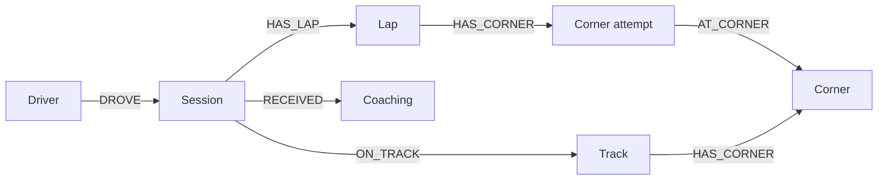

# Neo4j race memory

An Aura account needs a database instance before this works. In the [Aura console](https://console.neo4j.io/), open Instances and create an AuraDB Free instance if none exists. Wait for Running, save the generated password, and copy its connection URI. See the [official instance guide](https://neo4j.com/docs/aura/getting-started/create-instance/).

Put these fields in the project's `.env` (never in browser code or Git):

```dotenv
NEO4J_URI=neo4j+s://YOUR-INSTANCE.databases.neo4j.io
NEO4J_USERNAME=neo4j
NEO4J_PASSWORD=YOUR-GENERATED-PASSWORD
NEO4J_DATABASE=neo4j
```

Restart the server after editing `.env`; use `PORT=3100 npm run phone` to keep HTTPS phone steering available. Restarting changes the temporary phone URL, so scan the new QR code. The Neo4j JavaScript driver uses the server-side credentials. Queries use parameters, fixed labels, bounded result sizes and timeouts. Connection failures leave the local engineer usable.

## Verify without AI spending

Run `npm run memory:check`. Success returns `status: connected`; this also creates uniqueness constraints. `not_configured` means credentials are incomplete; `unavailable` means the driver could not complete a connection or query. Credentials and private database errors are never returned to the browser. Driver connection errors may need checking against the instance status and saved credentials.

Then open `/coach-lab.html`, turn **Engineer on**, leave **Automatic tips unchecked**, and click **Load 3 example laps into Neo4j**. The result should contain three laps and T4 loss totaling 0.67 seconds across three examples. Ask a question only when you want an ai& request. Responses must identify these as examples. `npm run memory:demo` does the same insertion and retrieval for a separate CLI demo driver.

Reload the practice page and ask about previous example laps to test retrieval across sessions. Repeating the load uses the same three lap IDs within a session; it does not duplicate them. A reload starts a new session, so loading again intentionally creates another session of examples.

## How the engineer uses it



On each coach request, the server retrieves up to five recent laps and three previous AI tips for the same driver, track and car mode. It includes measured corner losses and repeated problem corners in the AI prompt. Prior tips are advice, not evidence that the driver followed them. Only completed AI replies are saved as coaching records. Graph operations use no LLM or embedding calls; an explicit question or automatic tips still uses ai& credits.

The browser stores an anonymous driver ID in localStorage; clearing browser data creates a new driver. Sessions have fresh IDs on page reload. Live game and practice data use separate `live` and `demo` namespaces. Data stays in Aura until deleted there. These IDs scope application retrieval; they are not account authentication. Keep this prototype limited to trusted users.

Engineer **off** stops new lap writes and AI requests. Turning it on does not automatically spend AI credits. Existing graph writes already accepted by the database may finish after switching off. The **Check memory** button is an explicit database check and works without enabling AI.

## Yuan's analysis handoff

The existing `race:lap-summary` string event still works, storing text without inventing metrics. For graph comparisons, send a structured object with a stable ID per measured lap:

```js
window.dispatchEvent(new CustomEvent("race:lap-summary", {
  detail: {
    id: "session-lap-3",       // stable for retries; unique within this session
    lapNumber: 3,
    lapTimeSeconds: 132.4,
    summary: "T4 lost 0.35 s against the reference; braked 12 m early.",
    corners: [{
      name: "T4",             // stable across laps
      timeLostSeconds: 0.35,
      brakedEarlyMeters: 12,
      minimumSpeedDifferenceKmh: -6,
      throttlePickupLateMeters: 4
    }]
  }
}));
```

These numbers are examples. Send only values actually measured by analysis; omit unavailable metrics. Positive `brakedEarlyMeters` means braking earlier, negative `minimumSpeedDifferenceKmh` means slower than reference, and positive `throttlePickupLateMeters` means later throttle. Up to 32 corners are accepted. The game sets the track ID from the selected level. Existing car/phone WebSocket messages are unchanged.

The integration cannot create real lap/corner measurements by itself. Until Yuan's producer dispatches analysis, the game has live state and any manually supplied summaries; the practice page demonstrates graph memory using labeled examples.

To inspect the graph in Aura Query:

```cypher
MATCH (d:RaceDriver)-[:DROVE]->(s:RaceSession)-[:HAS_LAP]->(l:RaceLap)
WHERE d.dataset = 'demo'
OPTIONAL MATCH (l)-[:HAS_CORNER]->(a:RaceCornerAttempt)-[:AT_CORNER]->(c:RaceCorner)
RETURN d, s, l, a, c LIMIT 100
```
